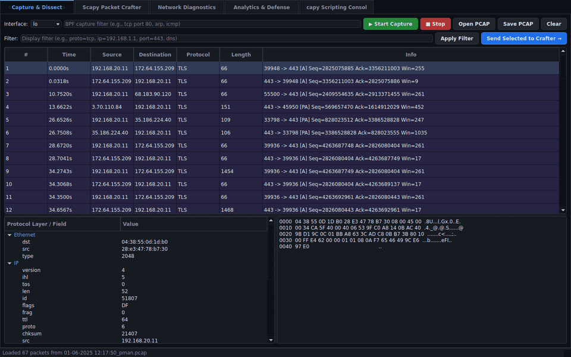

# Pman — Scapy Packet Analyzer, Crafter & Network Diagnostics


**Pman (Packet Manipulator)** is a Wireshark-style dark-mode GUI for **Scapy**—combining live packet capture, 3-pane protocol dissection, universal Scapy layer crafting & transmission, active network diagnostics, defensive traffic analytics, and an interactive Python/Scapy scripting console.

<p align="center">
  
</p>

---

## Features

1. **Capture & Dissect (`Capture & Dissect` tab):**
   - Live interface capture (`AsyncSniffer`) with BPF capture filters and a Wireshark-style display filter (`proto=tcp`, `ip=...`, `port=...`).
   - 3-pane inspector: color-coded Packet List, expandable Protocol Layer Tree (`fields_desc`), and Hex + ASCII dump.
   - PCAP import/export (`rdpcap` / `wrpcap`) and one-click **"Send Selected to Crafter"** to inspect or modify captured packets.
2. **Universal Scapy Packet Crafter (`Scapy Packet Crafter` tab):**
   - Stack and reorder any Scapy layer (`Ether`, `Dot1Q`, `ARP`, `IP`, `IPv6`, `ICMP`, `TCP`, `UDP`, `DNS`, `Raw`, plus all dynamically registered `conf.layers`).
   - Dynamic `fields_desc` editor table with live Python/Scapy code preview (`Ether()/IP(...)/TCP(...)`).
   - Transmit via L3 (`send`), L2 (`sendp`), or Send & Receive (`sr1`) with instant reply dissection.
3. **Network Diagnostics (`Network Diagnostics` tab):**
   - Non-blocking ARP subnet discovery, TCP port reachability probes, and Scapy L3 traceroute.
4. **Traffic Analytics & Defense (`Analytics & Defense` tab):**
   - Protocol distribution breakdown, top source/destination talkers, and automated anomaly alerts (SYN bursts, high RST rates, ICMP spikes, ARP IP-MAC conflicts, cleartext ports).
5. **Interactive Scapy Scripting Console (`Scapy Scripting Console` tab):**
   - Execute Python/Scapy scripts directly against loaded `packets` and `selected` packet, with built-in diagnostic presets.

---

## Architecture

```text
src/
├── main.py                      # Application entry point (auto-loads sample PCAP if present)
├── core/
│   ├── packet_engine.py         # PacketStore, PCAP I/O, display filtering, dissection, LiveSniffer
│   ├── scapy_builder.py         # Universal Scapy layer introspection, codegen, send/sendp/sr1
│   ├── diagnostics.py           # ARP discovery, TCP port probe, traceroute, defensive analytics
│   └── script_runner.py         # Interactive Scapy console execution & presets
└── ui/
    └── main_window.py           # Dark-mode PyQt5 5-tab interface
test/
└── test_pman_core.py            # Pytest unit & headless Qt5 GUI suite
```

---

## Installation & Quick Start

```bash
git clone https://github.com/YaminHaris/pman.git
cd pman
pip install -r requirements.txt

# Run the GUI (auto-loads sample capture)
python3 src/main.py

# For live raw-socket capture / L2 transmission on Linux:
sudo python3 src/main.py

# Run test suite
QT_QPA_PLATFORM=offscreen pytest -v test/test_pman_core.py
```

---

## License

Source-available — see [LICENSE](./LICENSE) for details.
